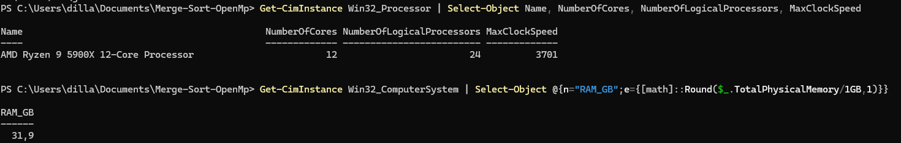
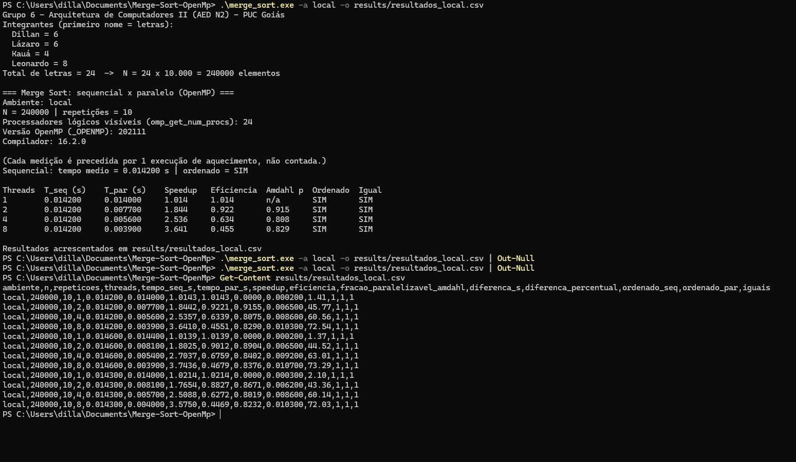
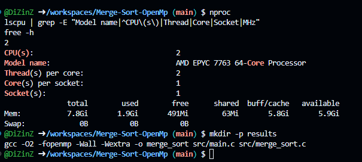
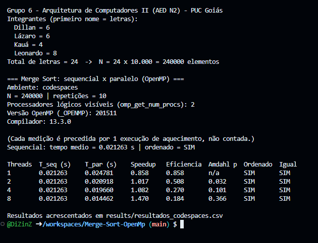
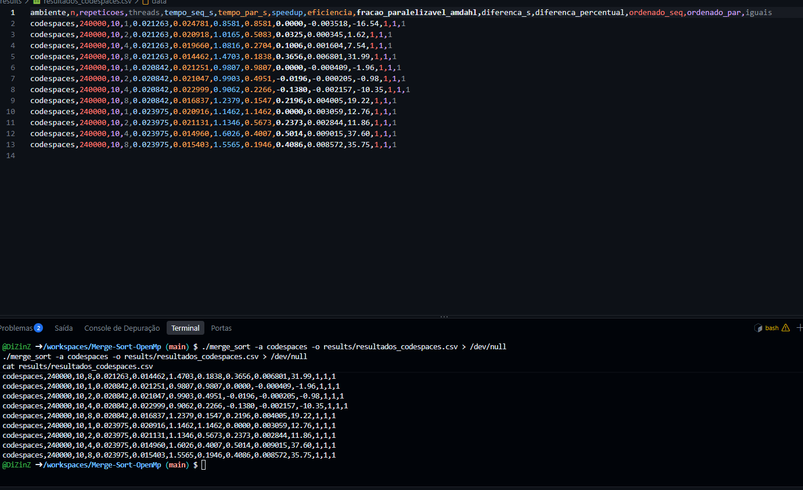
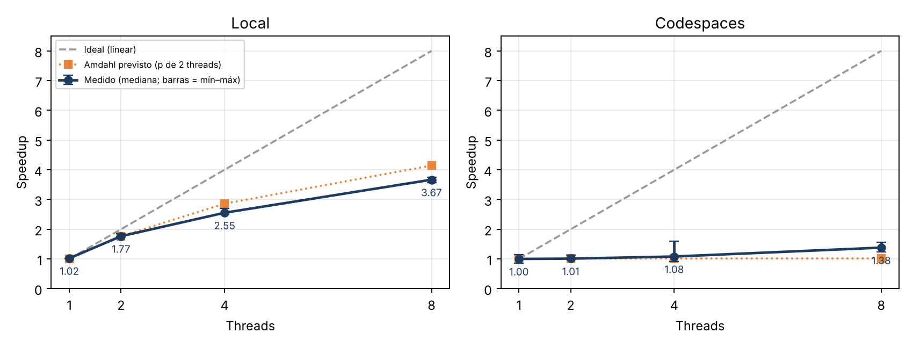

# Merge Sort Sequencial e Paralelo com OpenMP em C

**Arquitetura de Computadores II (CMP1059) – N2 2026/2 – PUC Goiás – Escola Politécnica**
**AED N2 001 – Algoritmos, Paralelismo e Execução na Nuvem** – Prof. Dr. Rovilson Mezencio
**Grupo 6**

## 1. Identificação

| Item | Informação |
|---|---|
| Integrantes | Dillan Fernandes de Almeida Silva, Lázaro Mateus Quixabeira Santos, Kauá dos Santos Leão, Leonardo Anacleto Maciel |
| Algoritmo | Merge Sort (ordenação por intercalação) |
| Linguagem | C (GCC com OpenMP) |
| Execução local | Windows 11, AMD Ryzen 9 5900X, GCC 16.2.0 (MSYS2 UCRT64) |
| Provedor de nuvem | GitHub Codespaces (Linux, GCC 13.3.0) |
| Repositório | https://github.com/DiZinZ/Merge-Sort-OpenMp |

**Cálculo de N** (soma das letras dos primeiros nomes × 10.000):

| Integrante | Primeiro nome | Letras |
|---|---|---|
| Dillan Fernandes de Almeida Silva | Dillan | 6 |
| Lázaro Mateus Quixabeira Santos | Lázaro | 6 |
| Kauá dos Santos Leão | Kauá | 4 |
| Leonardo Anacleto Maciel | Leonardo | 8 |
| **Total** | | **24** |

N = 24 × 10.000 = **240.000 elementos**. O programa imprime os nomes e o valor de N na saída.

**Justificativa da linguagem:** C dá controle direto sobre a memória e os vetores, o que deixa claros os acessos a `a` e `tmp` usados na análise de dependências. O GCC suporta OpenMP em Windows e Linux com as mesmas diretivas, e o custo de criar threads e tasks é baixo.

## 2. Descrição do algoritmo

O Merge Sort usa divisão e conquista: divide o vetor ao meio, ordena cada metade recursivamente e **intercala** as duas metades ordenadas em um vetor ordenado. A intercalação compara o menor elemento ainda não usado de cada metade e copia o menor para um vetor auxiliar. A complexidade é O(n log n) no pior caso e a ordenação é estável.

**Objetivo:** ordenar uma sequência de valores em ordem crescente.

**Aplicação real:** ordenação de grandes volumes de dados, como registros em bancos de dados e ordenação externa de arquivos que não cabem na memória. Variações do Merge Sort também são usadas em bibliotecas padrão de linguagens.

**Justificativa da escolha:** o enunciado indica que o Merge Sort tem partes independentes (as duas metades), o que permite uma demonstração rica de paralelização, e ao mesmo tempo tem uma parte sequencial (a intercalação), o que permite discutir os limites do paralelismo.

## 3. Análise das dependências de dados

As dependências abaixo estão apontadas no código-fonte com os comentários `[RAW-n]`, `[WAR-n]` e `[WAW-n]` (arquivo `src/merge_sort.c`). RAW é leitura depois de escrita (dependência verdadeira); WAR é escrita depois de leitura e WAW é escrita depois de escrita (dependências de nome).

```
static void intercalar(int *a, int *tmp, long lo, long mid, long hi) {
    long i = lo, j = mid, k = lo;

    /* [RAW-1] Este trecho LÊ a[lo..hi), escrito pelas duas chamadas recursivas
     *         das metades. A intercalação só pode começar depois delas.
     * [RAW-2] i, j e k são lidos e escritos a cada volta: a volta seguinte usa
     *         o valor que a anterior escreveu, e a escolha do próximo elemento
     *         depende de i e j. Por isso este laço é SEQUENCIAL.
     * [WAR-2] a[i] <= a[j] LÊ i e j; logo depois i++ ou j++ os ESCREVE
     *         (dependência de nome em escalares, resolvida com registradores).
     * [WAW-2] tmp[k] só é escrito na faixa [lo, hi) deste trecho. Faixas de
     *         trechos diferentes não se cruzam, então duas tasks nunca
     *         escrevem na mesma posição de tmp.
     */
    while (i < mid && j < hi)
        tmp[k++] = (a[i] <= a[j]) ? a[i++] : a[j++];
    while (i < mid) tmp[k++] = a[i++];
    while (j < hi)  tmp[k++] = a[j++];

    /* [RAW-3] memcpy LÊ tmp[lo..hi), escrito pelos laços acima.
     * [WAR-1] memcpy ESCREVE em a[lo..hi) depois que os laços LERAM a[i] e a[j];
     *         copiar antes destruiria valores ainda não lidos.
     * [WAW-1] a[lo..hi) já foi escrito pelas intercalações das metades; esta
     *         cópia o ESCREVE de novo, e a ordem das escritas precisa ser
     *         mantida (o pai escreve por último).
     */
    memcpy(a + lo, tmp + lo, (size_t)(hi - lo) * sizeof(int));
}
```

| ID | Tipo | Onde no código | O que acontece | Impõe execução sequencial? |
|---|---|---|---|---|
| RAW-1 | RAW | `intercalar` lê `a[lo..hi)` | Lê valores escritos pelas duas chamadas recursivas das metades | Sim: a intercalação só começa depois das duas metades (`taskwait`) |
| RAW-2 | RAW | laço `while` de `intercalar` (`i`, `j`, `k`) | Cada volta lê o `i`, `j` e `k` escritos pela volta anterior; a escolha do próximo elemento depende deles | Sim: o laço de uma intercalação é sequencial |
| RAW-3 | RAW | `memcpy` de `intercalar` | Lê `tmp[lo..hi)` escrito pelos laços | Sim: a cópia só ocorre depois dos laços |
| WAR-1 | WAR | `memcpy` de `intercalar` | Escreve em `a[lo..hi)` depois que os laços leram `a[i]` e `a[j]` | Sim: copiar antes destruiria valores ainda não lidos |
| WAR-2 | WAR | comparação `a[i] <= a[j]` e `i++`/`j++` | Lê `i` e `j` e depois os sobrescreve | Não: é dependência de nome em escalares, resolvida com registradores |
| WAW-1 | WAW | `a[lo..hi)` | Escrito pelas intercalações das metades e reescrito pelo `memcpy` do pai | Sim: a ordem das escritas deve ser mantida (`taskwait`) |
| WAW-2 | WAW | `tmp[lo..hi)` | Duas tasks escrevendo na mesma posição de `tmp` gerariam WAW | Não: cada trecho usa só a própria faixa de `tmp`, e as faixas não se cruzam |

**Resumo:**

- **Impõem ordem (sequencial):** RAW-1, RAW-3, WAR-1 e WAW-1 obrigam a intercalação a esperar as duas metades e a cópia a esperar os laços; RAW-2 faz o laço de intercalação ser sequencial.
- **Não impõem ordem:** WAR-2 e WAW-2 são dependências de nome. Elas desaparecem com renomeação (registradores para `i` e `j`) e com o uso de faixas disjuntas de `tmp`.
- **Independência das metades:** as chamadas para `[lo, mid)` e `[mid, hi)` leem e escrevem apenas em `a[lo..mid)`, `tmp[lo..mid)` e `a[mid..hi)`, `tmp[mid..hi)`. Os conjuntos são disjuntos, então não há RAW, WAR nem WAW entre elas: **podem executar em paralelo**.

## 4. Proposta de paralelização

**O que paralelizar:** as duas chamadas recursivas, que são independentes. **O que não paralelizar:** a intercalação, por causa de RAW-1, RAW-2, RAW-3, WAR-1 e WAW-1.

**Estratégia adotada:** paralelismo de tarefas (divisão e conquista) com OpenMP:

- `parallel` cria as threads e `single` faz com que uma só inicie a recursão;
- cada metade vira uma `task` que qualquer thread livre executa;
- `taskwait` garante RAW-1 e WAW-1: o pai só intercala depois dos filhos;
- um único `tmp`, indexado com as mesmas posições de `a`, evita WAW-2 sem precisar de cópias extras;
- `CUTOFF` de 5.000 elementos: abaixo desse tamanho a ordenação é sequencial, porque criar tasks muito pequenas custa mais do que ganha.

**Ligação com o livro Arquitetura e Organização de Computadores - 8ª Ed - William Stallings dos capítulos**:

- **Caps. 14 e 16 (paralelismo em nível de instrução):** RAW, WAR e WAW são os mesmos conflitos de dados vistos nesses capítulos. RAW é dependência verdadeira e não pode ser eliminada, como o `taskwait` e o laço de intercalação. WAR e WAW são dependências de nome e podem ser eliminadas por renomeação, como o uso de faixas separadas de `tmp`.
- **Cap. 17 (processamento paralelo):** as tasks distribuem subproblemas independentes entre processadores que compartilham a mesma memória, no estilo MIMD com memória compartilhada.
- **Cap. 18 (multicore):** as threads executam nos núcleos do processador, e o ganho é limitado pela quantidade de núcleos e processadores lógicos disponíveis, o que explica a diferença entre os dois ambientes.
- **Cap. 19 (GPU):** não usamos GPU. Justificativa: com N = 240.000 o problema é pequeno, e a intercalação tem a dependência RAW-2, que dificulta o paralelismo de dados fino que a GPU explora. A GPU costuma se adequar melhor a operações regulares sobre muitos dados independentes, como filtros de imagem.

## 5. Execução local

**Implementação e como executar** (Windows 11, PowerShell, na pasta do projeto):

```
gcc -O2 -fopenmp -Wall -Wextra -o merge_sort.exe src/main.c src/merge_sort.c
.\merge_sort.exe -a local -o results/resultados_local.csv
```

O programa gera um vetor com semente fixa, mede com `omp_get_wtime()` a média de 10 repetições (depois de 1 execução de aquecimento não contada), verifica se o vetor ficou ordenado e se o resultado paralelo é idêntico ao sequencial, e grava os resultados em CSV.

**Hardware local:** AMD Ryzen 9 5900X 12-Core, 12 núcleos físicos, 24 processadores lógicos, clock máximo informado de 3701 MHz, 31,9 GB de RAM.





**Tempos medidos (local):** mediana de 3 execuções do programa (cada uma com 10 repetições, após 1 execução de aquecimento não contada). Speedup = mediana do T_seq ÷ mediana do T_par.

| Threads | T_seq mediano (s) | T_par mediano (s) | Speedup | Faixa do speedup (3 rodadas) | Eficiência | Redução de tempo | p (Amdahl) |
|---|---|---|---|---|---|---|---|
| 1 | 0,014300 | 0,014000 | 1,021 | 1,014 a 1,021 | 1,021 | 2,1% | n/a |
| 2 | 0,014300 | 0,008100 | 1,765 | 1,765 a 1,844 | 0,883 | 43,4% | 0,867 |
| 4 | 0,014300 | 0,005600 | 2,554 | 2,509 a 2,704 | 0,638 | 60,8% | 0,811 |
| 8 | 0,014300 | 0,003900 | 3,667 | 3,575 a 3,744 | 0,458 | 72,7% | 0,831 |

**Speedup de cada execução:**

| Rodada | T_seq (s) | Speedup 1 thread | Speedup 2 threads | Speedup 4 threads | Speedup 8 threads |
|---|---|---|---|---|---|
| 1 | 0,014200 | 1,014 | 1,844 | 2,536 | 3,641 |
| 2 | 0,014600 | 1,014 | 1,802 | 2,704 | 3,744 |
| 3 | 0,014300 | 1,021 | 1,765 | 2,509 | 3,575 |

Em todas as repetições o vetor ficou ordenado e igual ao resultado sequencial.

## 6. Execução na nuvem

**Provedor e tipo de máquina:** GitHub Codespaces, ambiente de desenvolvimento em nuvem. A máquina é uma VM Linux (Ubuntu 24.04) com processador AMD EPYC 7763, **2 processadores lógicos** (1 núcleo físico com 2 threads) e 7,8 GiB de RAM, GCC 13.3.0.

**Justificativa da escolha:** o plano gratuito é suficiente, a máquina Linux já vem com o repositório e as ferramentas de compilação, qualquer integrante consegue repetir a execução pelo navegador e o ambiente é reproduzível. O custo é a pouca capacidade: apenas 2 processadores lógicos, o que limita o paralelismo e é discutido na seção 7.

Comandos:

```
sudo apt update && sudo apt install -y build-essential
gcc -O2 -fopenmp -Wall -Wextra -o merge_sort src/main.c src/merge_sort.c
./merge_sort -a codespaces -o results/resultados_codespaces.csv
```







**Tempos medidos (Codespaces):** mediana de 3 execuções do programa (10 repetições cada, após aquecimento). Speedup = mediana do T_seq ÷ mediana do T_par.

| Threads | T_seq mediano (s) | T_par mediano (s) | Speedup | Faixa do speedup (3 rodadas) | Eficiência | Redução de tempo | p (Amdahl) |
|---|---|---|---|---|---|---|---|
| 1 | 0,021263 | 0,021251 | 1,001 | 0,858 a 1,146 | 1,001 | 0,1% | n/a |
| 2 | 0,021263 | 0,021047 | 1,010 | 0,990 a 1,135 | 0,505 | 1,0% | 0,020 |
| 4 | 0,021263 | 0,019660 | 1,082 | 0,906 a 1,603 | 0,270 | 7,5% | 0,101 |
| 8 | 0,021263 | 0,015403 | 1,380 | 1,238 a 1,557 | 0,173 | 27,6% | 0,315 |

**Speedup de cada execução:**

| Rodada | T_seq (s) | Speedup 1 thread | Speedup 2 threads | Speedup 4 threads | Speedup 8 threads |
|---|---|---|---|---|---|
| 1 | 0,021263 | 0,858 | 1,016 | 1,082 | 1,470 |
| 2 | 0,020842 | 0,981 | 0,990 | 0,906 | 1,238 |
| 3 | 0,023975 | 1,146 | 1,135 | 1,603 | 1,557 |

**Comparativo local × nuvem (medianas):**

| Aspecto | Local (Ryzen 9 5900X) | Codespaces (EPYC 7763) |
|---|---|---|
| Processadores lógicos | 24 | 2 |
| Tempo sequencial | 0,014300 s | 0,021263 s |
| Melhor tempo paralelo | 0,003900 s (8 threads) | 0,015403 s (8 threads) |
| Melhor speedup | 3,667 (8 threads) | 1,380 (8 threads) |
| Speedup com 2 threads | 1,765 | 1,010 |
| Variação entre as 3 execuções (8 threads) | 3,575 a 3,744 | 1,238 a 1,557 |
| Comportamento | cresce a cada etapa, pouca variação | ganho pequeno, quase nulo até 4 threads, muita variação |

## 7. Discussão dos resultados

**O que melhorou:** no computador local o tempo mediano caiu de 14,3 ms para 3,9 ms com 8 threads (redução de 72,7%, speedup 3,667), e o ganho apareceu em todas as etapas (1,765 com 2 threads e 2,554 com 4). As 3 execuções deram resultados próximos (speedup com 8 threads entre 3,575 e 3,744). No Codespaces o ganho foi pequeno: speedup mediano de 1,010 com 2 threads e 1,380 com 8.

**O que surpreendeu:**

- No Codespaces, que tem 1 núcleo físico, 2 threads praticamente não trouxeram ganho (speedup 1,010), e o melhor resultado veio com 8 threads (1,380), mesmo com só 2 processadores lógicos. Não investigamos a causa. Uma hipótese, não testada, é que em um ambiente compartilhado mais threads ajudam a disputar tempo de CPU.
- A variação entre execuções no Codespaces é grande: com 4 threads o speedup ficou entre 0,906 e 1,603 nas três execuções, enquanto no local a variação foi pequena.
- Na primeira versão do programa, sem aquecimento, a primeira medição inflava o tempo sequencial: no Codespaces o speedup com 1 thread chegou a 1,24, quando deveria ser próximo de 1. Depois de incluir 1 execução de aquecimento não contada, a mediana com 1 thread ficou em 1,00 no Codespaces e 1,02 no local.

**Por que o speedup não é linear:** no local a eficiência cai com o aumento das threads (0,883 com 2 e 0,458 com 8). Uma explicação provável, ligada à seção 3, é que a intercalação não foi paralelizada (RAW-2): as últimas intercalações, que juntam trechos grandes, usam poucas threads. A criação de tasks e o acesso à memória também podem contribuir, mas não foram medidos separadamente.

**Limitações:**

- Os tempos são curtos (de 3,9 a 21,3 ms), então pequenas variações do sistema influenciam o resultado.
- No Windows os tempos aparecem em múltiplos de 0,1 ms (por exemplo, 0,014200 e 0,005600), o que indica resolução limitada do relógio; as médias de 10 repetições ficam menos precisas que no Linux.
- O Codespaces é um ambiente compartilhado e variou bastante entre as execuções; usamos apenas 3 execuções por ambiente.
- Os compiladores diferem entre os ambientes (GCC 16.2.0 e 13.3.0).
- Só testamos N = 240.000; não avaliamos como o speedup muda com outros tamanhos.

## 8. Código-fonte e referências

**Código-fonte:** https://github.com/DiZinZ/Merge-Sort-OpenMp

| Arquivo | Função |
|---|---|
| `src/main.c` | Programa principal: imprime nomes e N, mede tempos, calcula speedup, eficiência e Amdahl, grava CSV |
| `src/merge_sort.h` | Declarações e descrição das funções |
| `src/merge_sort.c` | Merge Sort sequencial e paralelo, verificações e comentários RAW/WAR/WAW |
| `results/*.csv` | Resultados medidos (local e Codespaces) |
| `README.md` | Instruções de instalação, compilação e execução |

**Referências:**

- Material e livro-texto da disciplina Arquitetura de Computadores II, caps. 14, 16, 17, 18 e 19, PUC Goiás.
- CORMEN, T. H.; LEISERSON, C. E.; RIVEST, R. L.; STEIN, C. Introduction to Algorithms. MIT Press.
- OPENMP ARCHITECTURE REVIEW BOARD. OpenMP Application Programming Interface. https://www.openmp.org
- GNU Project. GNU libgomp (OpenMP no GCC). https://gcc.gnu.org/onlinedocs/libgomp/
- AMDAHL, G. M. Validity of the single processor approach to achieving large scale computing capabilities. AFIPS Spring Joint Computer Conference, 1967.
- GITHUB. GitHub Codespaces documentation. https://docs.github.com/en/codespaces

## EXTRA-EXTRA: curva de speedup e Lei de Amdahl

**Speedup medido (mediana de 3 execuções) com 1, 2, 4 e 8 threads:**

| Threads | Speedup local | Eficiência local | Speedup Codespaces | Eficiência Codespaces |
|---|---|---|---|---|
| 1 | 1,021 | 1,021 | 1,001 | 1,001 |
| 2 | 1,765 | 0,883 | 1,010 | 0,505 |
| 4 | 2,554 | 0,638 | 1,082 | 0,270 |
| 8 | 3,667 | 0,458 | 1,380 | 0,173 |



**Fração paralelizável (Lei de Amdahl):** S = 1 / ((1 − p) + p / t), logo p = (1 − 1/S) / (1 − 1/t). A fração paralelizável estimada com cada medição foi:

| Threads | p local | p Codespaces |
|---|---|---|
| 2 | 0,867 | 0,020 |
| 4 | 0,811 | 0,101 |
| 8 | 0,831 | 0,315 |

**Speedup medido × previsto:** usando o p obtido com 2 threads (local 0,867; Codespaces 0,020) para prever 4 e 8 threads:

*Local:*

| Threads | Speedup medido | Speedup previsto (Amdahl) | Diferença |
|---|---|---|---|
| 1 | 1,021 | 1,000 | 0,021 |
| 2 | 1,765 | 1,765 | 0,000 |
| 4 | 2,554 | 2,860 | -0,306 |
| 8 | 3,667 | 4,145 | -0,478 |

*Codespaces:*

| Threads | Speedup medido | Speedup previsto (Amdahl) | Diferença |
|---|---|---|---|
| 1 | 1,001 | 1,000 | 0,001 |
| 2 | 1,010 | 1,010 | 0,000 |
| 4 | 1,082 | 1,015 | 0,066 |
| 8 | 1,380 | 1,018 | 0,362 |

Com o p de 2 threads, o speedup máximo teórico seria 7,5 no local e 1,0 no Codespaces.

**Por que a curva para de subir ou fica abaixo do previsto:**

- **Local:** o speedup continua subindo até 8 threads, pois há 24 processadores lógicos, mas fica abaixo do previsto (3,667 medido contra 4,145 previsto com 8 threads). Os p de 4 e 8 threads (cerca de 0,83) são menores que o de 2 threads (0,87): a fração sequencial real é um pouco maior e há custos que o modelo simples não inclui, como a criação de tasks e o acesso à memória. A causa não foi medida separadamente.
- **Codespaces:** o p estimado cresce com as threads (0,020, 0,101, 0,315), o contrário do que a Lei de Amdahl supõe (p constante). Isso mostra que o modelo não descreve bem esse ambiente, que é uma VM compartilhada com 2 processadores lógicos, onde a virtualização e a variação de carga pesam mais que a fração sequencial do algoritmo. Por isso o previsto com o p de 2 threads (quase 1,0) fica longe do medido com 8 threads (1,380).
- **Em ambos:** a parte sequencial do algoritmo vem da intercalação (RAW-2 e dependências associadas, seção 3): as últimas intercalações juntam trechos grandes e usam poucas threads.
